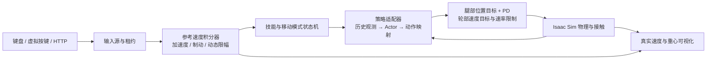

# Go2W 轮足机器人多技能强化学习项目说明

整理日期：2026-11-11。用途：本人复盘、面试准备和后续维护。当前事实以 `server_snapshot/portfolio_snapshot_metadata_20261111/evidence.json` 和部署 `config.json` 为准；`history/` 中的交接文档是历史快照，其参数不能覆盖新版本。

## 1. 项目到底做了什么

基于 Go2W 四足轮腿结构，在 Isaac Sim / Isaac Lab 中构建强化学习训练、技能部署、连续交互和远程手操系统。机器人具有 12 个腿关节和 4 个轮关节。移动部分分别训练抬腿与轮驱策略，另集成倒立、倒立恢复、趴下、起立与站立保持，通过统一控制器管理输入、制动和技能交接。

研究与工程重点是：如何让同一轮足机器人在前后移动、横移、原地转向、移动叠加转向、松键制动等不同需求下，保持合理支撑、姿态和动作连续性；以及如何保证训练得到的策略在交互环境中使用相同的观测、动作和时序。

这是仿真训练与部署项目。目前没有据此证明实机落地、可靠 sim2real、全地形通行或全技能高成功率。多策略入口不是一个统一端到端大模型，也不是导航规划系统。

## 2. 技术栈与实现归属

| 层次 | 采用的技术 | 本项目承担的工作 |
| --- | --- | --- |
| 物理与环境 | NVIDIA Isaac Sim 6.2、Isaac Lab 3、PhysX | 机器人资产、接触传感、环境配置、重置和终止规则 |
| 深度学习 | PyTorch、CUDA、Adam | Actor/Critic 结构、概率分布、训练损失、批量更新 |
| 移动强化学习 | 项目内 PPO 实现 | Rollout、GAE、PPO clipping、价值损失、熵、梯度裁剪、存档 |
| 任务设计 | 自定义奖励与课程 | 步态、镜像、支撑、接触、重心、转向、制动、站姿恢复 |
| 测试部署 | Python 适配器与状态机 | 观测与动作映射、技能独占电机、接口合同校验 |
| 远程操作 | Isaac WebRTC、HTTP bridge、原生/网页/虚拟键盘 | 多输入源管理、超时释放、状态和参考/实际速度显示 |
| 训练运维 | SSH、独立目录快照、监督进程、JSON/JSONL | 并行资源调度、检查点迁移、日志、预检与回归测试 |

当前抬腿和轮驱的 PPO 核心没有调用 RSL-RL、Stable-Baselines3 或 RL-Games 的训练器；PyTorch 负责自动微分、张量、网络和优化器，PPO 的数学算法是标准算法，不是原创发明。其他技能保留各自的训练代码，不能由移动部分的结论推断所有历史模块都使用同一套训练器。

## 3. 系统结构

训练链路：指令采样 → 参考速度积分 → 并行环境交互 → 存储观测/动作/奖励/终止 → GAE → PPO 多轮小批更新 → 分任务 gate → 保存 checkpoint。交互链路使用训练权重推理，不在手操过程中在线更新网络。

七个策略入口：`locomotion`（抬腿）、`wheel_locomotion`（轮驱）、`handstand`、`handstand_return`、`lying_down`、`getting_up`、`standing_hold`。站立保持复用起立策略的末段，因此是六份不同部署权重。

## 4. 移动策略的 PPO 方法

### 4.1 网络与观测

Actor 使用 10 帧历史，每帧 57 维，总输入 570 维。MLP 隐藏层为 256 → 128 → 128，隐藏激活为 ELU。抬腿输出 12 维，轮驱输出 16 维。Critic 输入 68 维，输出一个无激活的状态价值标量；Critic 使用当前帧及额外物理信息，而不是直接复用 Actor 的整段历史。

每帧包含：投影重力 3 维、机体角速度 3 维、腿关节相对基准位置 12 维、全关节速度 16 维、上一动作及占位 16 维、参考速度 3 维、航向误差 sin/cos 2 维、步态相位 sin/cos 2 维。具体相位门控与轮部占位以各策略 `frame()` 为准。

采用非对称 Actor–Critic：Actor 不输入仿真真值根部线速度、机身高度、接触、地图或图像；Critic 可使用这些额外训练信息中的速度、高度、接触及锚点误差。历史观测提供时间上下文。这是面向未来部署的设计考虑，不能替代实机观测噪声和时延验证。

Actor 输出高斯分布参数，采样潜变量后经过 Tanh 得到 [-1,1] 的有界动作。部署时使用确定性的均值经 Tanh。训练比率在潜变量高斯空间计算，不能把有界动作直接当成原始高斯样本。

### 4.2 目标函数和更新

GAE：`δ_t = r_t + γ(1-d_t)V(s_{t+1}) − V(s_t)`，`A_t = δ_t + γλ(1-d_t)A_{t+1}`。实现包括优势标准化、PPO 比率裁剪、裁剪价值损失、熵正则、镜像一致性损失、梯度范数裁剪和动作标准差限制。时间截断的 bootstrap 使用自动重置前保存的终端 Critic 状态，避免拿下一回合初态估值。

公共主要配置：rollout 32 步，4 个优化 epoch，每个 epoch 4 个 minibatch，γ=0.99、λ=0.95、clip=0.2、梯度范数上限 1。轮驱最新配置 lr=1e-4、entropy=0.002、symmetry_weight=0.5；抬腿 lr=5e-5、entropy=0.001、symmetry_weight=0.15。各 checkpoint 元数据是最终依据，文件中的前面几次 `PPO.update()` 可能已被后续覆盖。

4096 并行时每次 PPO 更新约采集 4096×32=131072 个环境控制步。所谓“200 轮”是 200 次 PPO 更新，不是 200 个 episode，也不是 checkpoint 编号本身。编号连续增长可能跨越多个续训版本。

### 4.3 对称性设计

左右镜像交换 FR↔FL、RR↔RL，侧向分量变号；角速度作为轴向量处理，对应 roll/yaw 分量变号；关节速度、上一动作、参考 vy/wz、航向误差同步镜像。对抬腿策略，左右映射会交换对角步态，需相应转换步态相位，不能只交换左右腿动作。

推理使用投影均值：`μ_sym(o)=0.5×[f(o)+M_a(f(M_o(o)))]`，此外训练有镜像损失与成对镜像指令采样。轮驱的轮部动作只交换左右轮槽位，不可无依据地把轮速全部取反。对称投影约束网络映射，不保证接触、摩擦、初态和实际运动天然完全对称，仍需分 Q/E 验收。

## 5. 动作与物理控制

抬腿：网络控制 12 个腿位置偏移；轮子采用零速度驱动与高阻尼近似锁轮。轮驱：网络控制 12 个腿位置偏移及 4 个绝对轮速度目标，最新版本不再用固定轮距运动学前馈加残差来限定转向几何。

腿目标受关节位置和目标变化速率限制，随后通过 PD 产生力矩；轮目标受速度、加速和制动速率限制。物理步长 0.005 s，控制步长 0.02 s，即 50 Hz 策略/目标更新和每控制周期 4 次物理子步。腿 kp=70、kd=2.5，力矩限幅约 ±23.5 N·m；抬腿腿目标速率 8 rad/s，轮驱 6 rad/s。轮驱轮目标加速/制动 60/100 rad/s²。不得把身体角速度、参考角加速度和轮电机角速度混为一谈。

训练中终止后允许重置；普通交互技能切换不靠改写根状态或瞬移完成动作，显式 R 重置是另一个操作。

## 6. 指令、步态与奖励

WASDQE 表示持续输入加速度，积分得到速度参考；松键按制动减速。反向输入先执行输入与制动共同作用，过零后再沿反方向加速。参考航向随角速度积分，松键制动结束后保持目标航向。

最新高速模式配置：

| 参数 | 抬腿 | 轮驱 |
| --- | --- | --- |
| 前进 / 后退上限 m/s | 2.3 / 1.5 | 3 / 2.5 |
| 横移上限 m/s | 1.3 | 不开放 A/D |
| 零平移参考时角速度上限 rad/s | 3.14 | 6.28 |
| 满平移参考速度时角速度上限 rad/s | 1.6 | 2 |
| 输入角加速度 rad/s² | 4.415625 | 4.8 |
| 制动角加速度 rad/s² | 7.065 | 19.2 |

令 `s=min(1,hypot(vx/Vx,vy/Vy))`，Vx 按前进/后退分别选对应速度上限。角速度包络为 `w_cap=w_fast+(w_zero−w_fast)×(exp(−3s)−exp(−3))/(1−exp(−3))`。上限下降时按制动速率回落，可能短暂高于新目标上限，而不瞬间截断指令。K 切换低速时将所有方向的线速度及整个角速度包络减半，加减速度不变；M 切换轮驱/抬腿并保留速度档位。

抬腿参考周期为 0.28 s，并在 0.23–0.33 s 之间采样。用户早期“0.25–0.35”的需求在此按周期秒理解，不是 0.25–0.35 Hz。周期只构成步态参考，不意味着四条腿都已以同一精确实测周期运动。

抬腿奖励涵盖速度/航向跟踪、对角足时序、摆动抬足缺失、拖地、支撑滑移、矢状面运动、前进外拐抑制、转向切向运动与停止重心漂移。轮驱包含速度跟踪、四轮接触、离地高度、前后足间距、前后轮距、机身过度俯仰、支撑多边形、重心/ZMP 近似指导、转向制动、直行姿态/速度对称和静止恢复。

重心指导考虑参考加速度以及转弯的 `v×ω` 项，按重心高度估计平衡偏移；接触支撑及 ZMP 项为近似奖励，不是严格的全身动力学 MPC 或稳定性证明。高速及转向时允许合适的机身调整，避免始终强逼固定站姿。

最新轮驱后退专项：后轮间距不足基准的 95%（约 0.3634 m）时处罚；两后足到机身中线的有符号侧向距离不足基准半轮距的 90% 时分别处罚，能检测交叉。转向门控连续弱化至直线后退的 25%，保留横向重心调整。实际仍后退时，即便参考已松开也可保留约束。这是软奖励，不是强制几何下限。

## 7. 问题、分析、处理和证据

| 问题 | 分析与定位 | 实施方法 | 当前证据与边界 |
| --- | --- | --- | --- |
| 抬腿 Q/E 差异大、单向拖腿 | 指令、关节、航向和相位镜像必须完整；总体平均掩盖单侧问题 | 镜像观测/动作、投影 Actor、对称损失、相邻成对采样；分 Q/E gate | 有镜像数值校验和分侧日志；不能只凭代码断言实际转向完全一致 |
| W 前进外摆甩腿、足聚拢 | 仅奖励速度会容许侧摆取巧；仅强姿态约束又会阻碍抬足 | 前进髋外拐死区惩罚、矢状面指导、摆动抬足/拖地奖励、对角时序 | 用户手操反馈抬腿已接近理想；仍需同条件旧新对照视频与统计 |
| 轮驱低速 QE 不灵敏 | 固定轮速前馈/机械包络与固定站姿限制策略调整轮位 | 改为四轮绝对速度动作，允许腿位变化；保留电机饱和，强化转向采样 | 新动作合同和代码可核对；不是自动获得阿克曼转向结构 |
| 高速组合转弯重心不稳 | 忽略横向加速度，或对转向必需滑移过度处罚 | 重心偏移、支撑/ZMP、转向相关高度、接触与过倾处罚；组合采样 | 有几何/接触/gate 日志；高上限阶段曾出现较低综合通过率，尚非全包络稳定 |
| 轮驱后退后腿内收 | 原通用轮距门槛仅为默认 80%；内收指标被记录但未充分约束 | 新增后退专用有符号侧距和 95% 后轮距约束，镜像与梯度方向测试 | 函数测试证明方向正确；不能把阈值配置说成实测始终满足 |
| 松键仍蜷腿，站姿恢复不启动 | 旧辅助要求实际速度先低于 0.12；残余运动可能一直阻断恢复 | 释放输入及参考速度决定连续恢复目标，取消实际速度前置条件；训练恢复奖励加强 | W/S/Q/E 独立恢复物理测试通过；运行时辅助也有贡献，不能全部归功于 PPO |
| 角速度与角加速度需求混淆 | 单位不同：rad/s 与 rad/s² | 先保留曾误改的训练记录，再把加速度回调 4.8、原地速度提升 6.28，另训 200 更新 | 最终轮驱 3624 的 checkpoint 合同和测试配置一致 |
| 测试速度显示仍像旧上限 | 活跃移动 profile 与通用配置显示可能混淆 | 从 checkpoint 合同构造 profile；显示当前档位、动态上限、参考与真实速度 | 导入校验、/status、串流状态记录；显示正确不等于实测达上限 |
| 训练正常但交互动作不一致 | 观测顺序、历史、相位、前一动作、控制速率或资产几何可能不同 | 专用适配器、源代码/URDF 哈希合同、从训练代码提取 frame/target 对照 | 原始输出 parity 检查通过；碰撞几何覆盖仍需明确记录 |
| 显存不足或资源闲置 | 多 Isaac 进程均有固定启动开销；进程数量不等于环境数量 | 调整 2048/4096 并行，先低并行预检，再正式训练；暂停冲突任务、独立监督 | 4096 并行两次轮驱 200 更新完成；不等于任意更多进程都会更快 |
| 文档说 running，但进程已退出 | 状态 JSON 是最后一次写入，不是实时进程监测 | 对照 PID、checkpoint、进度日志、exit_code 与完成状态，使用最新有效存档 | 抬腿 600 轮未完整结束，部署 10274；不能写成全部 600 已完成 |
| P 低姿态却不完成；H 仍抖动 | 策略目标、增益释放与完成判据不同；动作差分/饱和会影响平滑 | 分离时间线暂停和任务卡住；保留分技能审计、旧新初态与饱和指标 | 原交接仍记录 P 未可靠完成、H 抖动和恢复分布差异；未据新移动训练认定解决 |

## 8. 当前版本与已验证结果

轮驱最新部署为 `go2w_wheel_yaw628_200_20261111/logs/train/policy_3624.pt`，由 3424 接续 200 更新，4096 并行；完成状态为 complete。3424 来自上一轮角加速度 6.28 的误解版本；最终 3624 已恢复输入角加速度 4.8，并学习新的角速度包络。

抬腿部署为 `go2w_step_rearfix600_20261111/logs/train/policy_10274.pt`。从 9899 的可用存档计算，部署权重对应该轮续训 375 次更新；后续日志可以比保存的权重更晚，不能把末行成绩全归给 10274。历史状态文件曾残留 running；原目标 10499 并未作为当前权重。

站姿恢复修复的独立四方向测试（当时的策略版本）中，释放后观察至 8 s：电机目标最终误差 0，实际姿态对默认实测站姿的 RMS 误差约 0.060–0.066 rad，最终平移速度约 0.0012–0.0034 m/s、偏航角速度不超过 0.0022 rad/s。样本是 W/S/Q/E 各一条短轨迹，不是百次随机试验，也不是“0.8 秒内完成实测恢复”的证明。

部署 3624/10274 的导入对照中，抬腿单帧最大误差约 1.0e-6、轮驱约 4.7e-6；轮驱原始腿/轮目标差异为 0。测试会在比较原始策略时关闭辅助，再另测恢复，避免辅助把 parity 比较污染。这是接口一致性结果，不是运动成功率。

最新轮驱训练日志的 3624 行：当前帧四轮接触比例约 94.82%，纵向跟踪 RMSE 约 0.356 m/s、偏航跟踪 RMSE 约 0.346 rad/s。最近的综合 gate 在 3599 行，通过率约 38.45%，转向专项约 25%；它评的是 3599，不是最终 3624。该阶段已扩大指令范围，不能和旧 1399 的小包络指标直接横向排名。完整分组原始结果见第五份证据索引。

历史 2026-11-10 的 7099 抬腿纯 QE 通过率 89.65%、组合转向 10.16%；轮驱 1399 的专项 gate 通过率 31.25%。这些只用于说明为什么后续重点优化组合转向，不能包装成最新 3624/10274 的性能。最新 gate 原始记录随快照保留，需按版本、指令包络、初态和判据阅读。

## 9. 已知局限与下一步

1. 最新轮驱 6.28 是命令上限，尚需独立验证实际可达转速、稳定保持和停止距离；需覆盖 Q/E、前后组合与高/低速档。
2. 需要固定初态、随机种子、摩擦和指令集，对旧/新策略做公平 A/B；分别统计失败、接触、漂移、跟踪误差、关节/力矩饱和，不能只展示最好片段。
3. 交互恢复辅助与神经策略的作用需分开评估；最终可考虑减少辅助依赖，但不能直接删除后宣称策略已会恢复。
4. 策略输入有历史，但没有经过真实 IMU/编码器噪声、执行延迟和驱动模型标定。部署到实机前仍需传感与控制链路适配。
5. ZMP 与接触奖励只是近似引导；地图已加载不代表通过全部台阶、坡面和障碍。
6. 历史工程含大量日期目录及配置覆盖，适合实验追溯但不利于长期维护。后续可以提炼单一配置系统和统一实验管理，不能在归档时直接重构并破坏权重哈希。

## 10. 对外介绍时怎样准确表达

可说“基于 Isaac Lab 和 PyTorch 实现轮足机器人移动 PPO 训练与多技能仿真部署，完成对称约束、支撑/重心奖励、组合指令课程和训练—部署一致性校验，支持 4096 并行环境及 WebRTC 手操”。应能解释每一项对应哪段代码、哪个实验与哪个失败案例。

不要写“原创 PPO 算法”“单模型统一全部技能”“实现可靠实机部署”“6.28 rad/s 稳定实测转速”“全地形通过”“所有训练全部收敛”。个人职责需按本人实际参与程度描述；使用 AI 辅助编程不妨碍项目价值，但不能把自动生成和未独立理解的实现包装成完全手写的原创研究。

## 11. 2026-11-12 增补：MuJoCo 与倒立针对性蒸馏

前十节描述 2026-11-11 服务器归档，所列部署、上限与未解决问题按当时理解；不代表当前本地 MuJoCo 状态。后续运行工程位于 `../../mujoco_latest/`，未改写 `server_snapshot/` 的源码、权重及哈希。

当前本地抬腿为 10474、轮驱回退至提速前的 3824，倒立使用针对性蒸馏后的 student_999（目录 `handstand_targeted_20261112`，不能与首次蒸馏的同名权重混淆）。P/U、站立保持和倒立返回沿用原权重。

首次学生在 Isaac 中通过评估，却在 MuJoCo 约 4.88 s 失稳。教师在同一环境正常，改变摩擦未解决学生问题；诊断显示关键前轮动作误差、支撑点偏移与跨引擎状态分布变化。采集 MuJoCo 真实访问状态的教师标签，混合在线 PhysX DAgger，并增加分层回放及关键动作权重后，学生通过六类场景、共 12 次连续倒立与返回测试。2.5–4.0 s 阶段前轮支撑锚点偏移峰值约 0.391→0.168 m，接近教师 0.169 m。该量包含正常滚动，不能称为纯打滑距离；未做逐项消融，不能归因于单一改动。

完整更新：[Sim-to-Sim 项目说明](../../mujoco_latest/申校材料/Go2W_Sim2Sim_项目说明.md)、[本次问题复盘](../../mujoco_latest/申校材料/倒立针对性蒸馏复盘_20261112.md)。包含数据覆盖、关键动作损失、训练地点、验收范围及实机可观测性边界。最新导入证据为 `../../mujoco_latest/handstand_distill_20261112/targeted_import_result.json`。
