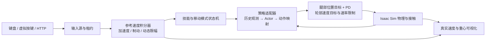

# Go2W 项目说明合订本

本文件供本人连续阅读，由 docs 中五份说明合并。代码、资产与权重位于同目录 server_snapshot；阅读入口为 README.md。原始快照不因文档整理而修改。


---

# Go2W 轮足机器人多技能强化学习项目说明

整理日期：2026-11-11。用途：本人复盘、面试准备和后续维护。当前事实以 `server_snapshot/portfolio_snapshot_metadata_20261111/evidence.json` 和部署 `config.json` 为准；`history/` 中的交接文档是历史快照，其参数不能覆盖新版本。

## 1. 项目到底做了什么

基于 Go2W 四足轮腿结构，在 Isaac Sim / Isaac Lab 中构建强化学习训练、技能部署、连续交互和远程手操系统。机器人具有 12 个腿关节和 4 个轮关节。移动部分分别训练抬腿与轮驱策略，另集成倒立、倒立恢复、趴下、起立与站立保持，通过统一控制器管理输入、制动和技能交接。

研究与工程重点是：如何让同一轮足机器人在前后移动、横移、原地转向、移动叠加转向、松键制动等不同需求下，保持合理支撑、姿态和动作连续性；以及如何保证训练得到的策略在交互环境中使用相同的观测、动作和时序。

这是仿真训练与部署项目。目前没有据此证明实机落地、可靠 sim2real、全地形通行或全技能高成功率。多策略入口不是一个统一端到端大模型，也不是导航规划系统。

## 2. 技术栈与实现归属

| 层次 | 采用的技术 | 本项目承担的工作 |
| --- | --- | --- |
| 物理与环境 | NVIDIA Isaac Sim 6.2、Isaac Lab 3、PhysX | 机器人资产、接触传感、环境配置、重置和终止规则 |
| 深度学习 | PyTorch、CUDA、Adam | Actor/Critic 结构、概率分布、训练损失、批量更新 |
| 移动强化学习 | 项目内 PPO 实现 | Rollout、GAE、PPO clipping、价值损失、熵、梯度裁剪、存档 |
| 任务设计 | 自定义奖励与课程 | 步态、镜像、支撑、接触、重心、转向、制动、站姿恢复 |
| 测试部署 | Python 适配器与状态机 | 观测与动作映射、技能独占电机、接口合同校验 |
| 远程操作 | Isaac WebRTC、HTTP bridge、原生/网页/虚拟键盘 | 多输入源管理、超时释放、状态和参考/实际速度显示 |
| 训练运维 | SSH、独立目录快照、监督进程、JSON/JSONL | 并行资源调度、检查点迁移、日志、预检与回归测试 |

当前抬腿和轮驱的 PPO 核心没有调用 RSL-RL、Stable-Baselines3 或 RL-Games 的训练器；PyTorch 负责自动微分、张量、网络和优化器，PPO 的数学算法是标准算法，不是原创发明。其他技能保留各自的训练代码，不能由移动部分的结论推断所有历史模块都使用同一套训练器。

## 3. 系统结构



训练链路：指令采样 → 参考速度积分 → 并行环境交互 → 存储观测/动作/奖励/终止 → GAE → PPO 多轮小批更新 → 分任务 gate → 保存 checkpoint。交互链路使用训练权重推理，不在手操过程中在线更新网络。

七个策略入口：`locomotion`（抬腿）、`wheel_locomotion`（轮驱）、`handstand`、`handstand_return`、`lying_down`、`getting_up`、`standing_hold`。站立保持复用起立策略的末段，因此是六份不同部署权重。

## 4. 移动策略的 PPO 方法

### 4.1 网络与观测

Actor 使用 10 帧历史，每帧 57 维，总输入 570 维。MLP 隐藏层为 256 → 128 → 128，隐藏激活为 ELU。抬腿输出 12 维，轮驱输出 16 维。Critic 输入 68 维，输出一个无激活的状态价值标量；Critic 使用当前帧及额外物理信息，而不是直接复用 Actor 的整段历史。

每帧包含：投影重力 3 维、机体角速度 3 维、腿关节相对基准位置 12 维、全关节速度 16 维、上一动作及占位 16 维、参考速度 3 维、航向误差 sin/cos 2 维、步态相位 sin/cos 2 维。具体相位门控与轮部占位以各策略 `frame()` 为准。

采用非对称 Actor–Critic：Actor 不输入仿真真值根部线速度、机身高度、接触、地图或图像；Critic 可使用这些额外训练信息中的速度、高度、接触及锚点误差。历史观测提供时间上下文。这是面向未来部署的设计考虑，不能替代实机观测噪声和时延验证。

Actor 输出高斯分布参数，采样潜变量后经过 Tanh 得到 [-1,1] 的有界动作。部署时使用确定性的均值经 Tanh。训练比率在潜变量高斯空间计算，不能把有界动作直接当成原始高斯样本。

### 4.2 目标函数和更新

GAE：`δ_t = r_t + γ(1-d_t)V(s_{t+1}) − V(s_t)`，`A_t = δ_t + γλ(1-d_t)A_{t+1}`。实现包括优势标准化、PPO 比率裁剪、裁剪价值损失、熵正则、镜像一致性损失、梯度范数裁剪和动作标准差限制。时间截断的 bootstrap 使用自动重置前保存的终端 Critic 状态，避免拿下一回合初态估值。

公共主要配置：rollout 32 步，4 个优化 epoch，每个 epoch 4 个 minibatch，γ=0.99、λ=0.95、clip=0.2、梯度范数上限 1。轮驱最新配置 lr=1e-4、entropy=0.002、symmetry_weight=0.5；抬腿 lr=5e-5、entropy=0.001、symmetry_weight=0.15。各 checkpoint 元数据是最终依据，文件中的前面几次 `PPO.update()` 可能已被后续覆盖。

4096 并行时每次 PPO 更新约采集 4096×32=131072 个环境控制步。所谓“200 轮”是 200 次 PPO 更新，不是 200 个 episode，也不是 checkpoint 编号本身。编号连续增长可能跨越多个续训版本。

### 4.3 对称性设计

左右镜像交换 FR↔FL、RR↔RL，侧向分量变号；角速度作为轴向量处理，对应 roll/yaw 分量变号；关节速度、上一动作、参考 vy/wz、航向误差同步镜像。对抬腿策略，左右映射会交换对角步态，需相应转换步态相位，不能只交换左右腿动作。

推理使用投影均值：`μ_sym(o)=0.5×[f(o)+M_a(f(M_o(o)))]`，此外训练有镜像损失与成对镜像指令采样。轮驱的轮部动作只交换左右轮槽位，不可无依据地把轮速全部取反。对称投影约束网络映射，不保证接触、摩擦、初态和实际运动天然完全对称，仍需分 Q/E 验收。

## 5. 动作与物理控制

抬腿：网络控制 12 个腿位置偏移；轮子采用零速度驱动与高阻尼近似锁轮。轮驱：网络控制 12 个腿位置偏移及 4 个绝对轮速度目标，最新版本不再用固定轮距运动学前馈加残差来限定转向几何。

腿目标受关节位置和目标变化速率限制，随后通过 PD 产生力矩；轮目标受速度、加速和制动速率限制。物理步长 0.005 s，控制步长 0.02 s，即 50 Hz 策略/目标更新和每控制周期 4 次物理子步。腿 kp=70、kd=2.5，力矩限幅约 ±23.5 N·m；抬腿腿目标速率 8 rad/s，轮驱 6 rad/s。轮驱轮目标加速/制动 60/100 rad/s²。不得把身体角速度、参考角加速度和轮电机角速度混为一谈。

训练中终止后允许重置；普通交互技能切换不靠改写根状态或瞬移完成动作，显式 R 重置是另一个操作。

## 6. 指令、步态与奖励

WASDQE 表示持续输入加速度，积分得到速度参考；松键按制动减速。反向输入先执行输入与制动共同作用，过零后再沿反方向加速。参考航向随角速度积分，松键制动结束后保持目标航向。

最新高速模式配置：

| 参数 | 抬腿 | 轮驱 |
| --- | --- | --- |
| 前进 / 后退上限 m/s | 2.3 / 1.5 | 3 / 2.5 |
| 横移上限 m/s | 1.3 | 不开放 A/D |
| 零平移参考时角速度上限 rad/s | 3.14 | 6.28 |
| 满平移参考速度时角速度上限 rad/s | 1.6 | 2 |
| 输入角加速度 rad/s² | 4.415625 | 4.8 |
| 制动角加速度 rad/s² | 7.065 | 19.2 |

令 `s=min(1,hypot(vx/Vx,vy/Vy))`，Vx 按前进/后退分别选对应速度上限。角速度包络为 `w_cap=w_fast+(w_zero−w_fast)×(exp(−3s)−exp(−3))/(1−exp(−3))`。上限下降时按制动速率回落，可能短暂高于新目标上限，而不瞬间截断指令。K 切换低速时将所有方向的线速度及整个角速度包络减半，加减速度不变；M 切换轮驱/抬腿并保留速度档位。

抬腿参考周期为 0.28 s，并在 0.23–0.33 s 之间采样。用户早期“0.25–0.35”的需求在此按周期秒理解，不是 0.25–0.35 Hz。周期只构成步态参考，不意味着四条腿都已以同一精确实测周期运动。

抬腿奖励涵盖速度/航向跟踪、对角足时序、摆动抬足缺失、拖地、支撑滑移、矢状面运动、前进外拐抑制、转向切向运动与停止重心漂移。轮驱包含速度跟踪、四轮接触、离地高度、前后足间距、前后轮距、机身过度俯仰、支撑多边形、重心/ZMP 近似指导、转向制动、直行姿态/速度对称和静止恢复。

重心指导考虑参考加速度以及转弯的 `v×ω` 项，按重心高度估计平衡偏移；接触支撑及 ZMP 项为近似奖励，不是严格的全身动力学 MPC 或稳定性证明。高速及转向时允许合适的机身调整，避免始终强逼固定站姿。

最新轮驱后退专项：后轮间距不足基准的 95%（约 0.3634 m）时处罚；两后足到机身中线的有符号侧向距离不足基准半轮距的 90% 时分别处罚，能检测交叉。转向门控连续弱化至直线后退的 25%，保留横向重心调整。实际仍后退时，即便参考已松开也可保留约束。这是软奖励，不是强制几何下限。

## 7. 问题、分析、处理和证据

| 问题 | 分析与定位 | 实施方法 | 当前证据与边界 |
| --- | --- | --- | --- |
| 抬腿 Q/E 差异大、单向拖腿 | 指令、关节、航向和相位镜像必须完整；总体平均掩盖单侧问题 | 镜像观测/动作、投影 Actor、对称损失、相邻成对采样；分 Q/E gate | 有镜像数值校验和分侧日志；不能只凭代码断言实际转向完全一致 |
| W 前进外摆甩腿、足聚拢 | 仅奖励速度会容许侧摆取巧；仅强姿态约束又会阻碍抬足 | 前进髋外拐死区惩罚、矢状面指导、摆动抬足/拖地奖励、对角时序 | 用户手操反馈抬腿已接近理想；仍需同条件旧新对照视频与统计 |
| 轮驱低速 QE 不灵敏 | 固定轮速前馈/机械包络与固定站姿限制策略调整轮位 | 改为四轮绝对速度动作，允许腿位变化；保留电机饱和，强化转向采样 | 新动作合同和代码可核对；不是自动获得阿克曼转向结构 |
| 高速组合转弯重心不稳 | 忽略横向加速度，或对转向必需滑移过度处罚 | 重心偏移、支撑/ZMP、转向相关高度、接触与过倾处罚；组合采样 | 有几何/接触/gate 日志；高上限阶段曾出现较低综合通过率，尚非全包络稳定 |
| 轮驱后退后腿内收 | 原通用轮距门槛仅为默认 80%；内收指标被记录但未充分约束 | 新增后退专用有符号侧距和 95% 后轮距约束，镜像与梯度方向测试 | 函数测试证明方向正确；不能把阈值配置说成实测始终满足 |
| 松键仍蜷腿，站姿恢复不启动 | 旧辅助要求实际速度先低于 0.12；残余运动可能一直阻断恢复 | 释放输入及参考速度决定连续恢复目标，取消实际速度前置条件；训练恢复奖励加强 | W/S/Q/E 独立恢复物理测试通过；运行时辅助也有贡献，不能全部归功于 PPO |
| 角速度与角加速度需求混淆 | 单位不同：rad/s 与 rad/s² | 先保留曾误改的训练记录，再把加速度回调 4.8、原地速度提升 6.28，另训 200 更新 | 最终轮驱 3624 的 checkpoint 合同和测试配置一致 |
| 测试速度显示仍像旧上限 | 活跃移动 profile 与通用配置显示可能混淆 | 从 checkpoint 合同构造 profile；显示当前档位、动态上限、参考与真实速度 | 导入校验、/status、串流状态记录；显示正确不等于实测达上限 |
| 训练正常但交互动作不一致 | 观测顺序、历史、相位、前一动作、控制速率或资产几何可能不同 | 专用适配器、源代码/URDF 哈希合同、从训练代码提取 frame/target 对照 | 原始输出 parity 检查通过；碰撞几何覆盖仍需明确记录 |
| 显存不足或资源闲置 | 多 Isaac 进程均有固定启动开销；进程数量不等于环境数量 | 调整 2048/4096 并行，先低并行预检，再正式训练；暂停冲突任务、独立监督 | 4096 并行两次轮驱 200 更新完成；不等于任意更多进程都会更快 |
| 文档说 running，但进程已退出 | 状态 JSON 是最后一次写入，不是实时进程监测 | 对照 PID、checkpoint、进度日志、exit_code 与完成状态，使用最新有效存档 | 抬腿 600 轮未完整结束，部署 10274；不能写成全部 600 已完成 |
| P 低姿态却不完成；H 仍抖动 | 策略目标、增益释放与完成判据不同；动作差分/饱和会影响平滑 | 分离时间线暂停和任务卡住；保留分技能审计、旧新初态与饱和指标 | 原交接仍记录 P 未可靠完成、H 抖动和恢复分布差异；未据新移动训练认定解决 |

## 8. 当前版本与已验证结果

轮驱最新部署为 `go2w_wheel_yaw628_200_20261111/logs/train/policy_3624.pt`，由 3424 接续 200 更新，4096 并行；完成状态为 complete。3424 来自上一轮角加速度 6.28 的误解版本；最终 3624 已恢复输入角加速度 4.8，并学习新的角速度包络。

抬腿部署为 `go2w_step_rearfix600_20261111/logs/train/policy_10274.pt`。从 9899 的可用存档计算，部署权重对应该轮续训 375 次更新；后续日志可以比保存的权重更晚，不能把末行成绩全归给 10274。历史状态文件曾残留 running；原目标 10499 并未作为当前权重。

站姿恢复修复的独立四方向测试（当时的策略版本）中，释放后观察至 8 s：电机目标最终误差 0，实际姿态对默认实测站姿的 RMS 误差约 0.060–0.066 rad，最终平移速度约 0.0012–0.0034 m/s、偏航角速度不超过 0.0022 rad/s。样本是 W/S/Q/E 各一条短轨迹，不是百次随机试验，也不是“0.8 秒内完成实测恢复”的证明。

部署 3624/10274 的导入对照中，抬腿单帧最大误差约 1.0e-6、轮驱约 4.7e-6；轮驱原始腿/轮目标差异为 0。测试会在比较原始策略时关闭辅助，再另测恢复，避免辅助把 parity 比较污染。这是接口一致性结果，不是运动成功率。

最新轮驱训练日志的 3624 行：当前帧四轮接触比例约 94.82%，纵向跟踪 RMSE 约 0.356 m/s、偏航跟踪 RMSE 约 0.346 rad/s。最近的综合 gate 在 3599 行，通过率约 38.45%，转向专项约 25%；它评的是 3599，不是最终 3624。该阶段已扩大指令范围，不能和旧 1399 的小包络指标直接横向排名。完整分组原始结果见第五份证据索引。

历史 2026-11-10 的 7099 抬腿纯 QE 通过率 89.65%、组合转向 10.16%；轮驱 1399 的专项 gate 通过率 31.25%。这些只用于说明为什么后续重点优化组合转向，不能包装成最新 3624/10274 的性能。最新 gate 原始记录随快照保留，需按版本、指令包络、初态和判据阅读。

## 9. 已知局限与下一步

1. 最新轮驱 6.28 是命令上限，尚需独立验证实际可达转速、稳定保持和停止距离；需覆盖 Q/E、前后组合与高/低速档。
2. 需要固定初态、随机种子、摩擦和指令集，对旧/新策略做公平 A/B；分别统计失败、接触、漂移、跟踪误差、关节/力矩饱和，不能只展示最好片段。
3. 交互恢复辅助与神经策略的作用需分开评估；最终可考虑减少辅助依赖，但不能直接删除后宣称策略已会恢复。
4. 策略输入有历史，但没有经过真实 IMU/编码器噪声、执行延迟和驱动模型标定。部署到实机前仍需传感与控制链路适配。
5. ZMP 与接触奖励只是近似引导；地图已加载不代表通过全部台阶、坡面和障碍。
6. 历史工程含大量日期目录及配置覆盖，适合实验追溯但不利于长期维护。后续可以提炼单一配置系统和统一实验管理，不能在归档时直接重构并破坏权重哈希。

## 10. 对外介绍时怎样准确表达

可说“基于 Isaac Lab 和 PyTorch 实现轮足机器人移动 PPO 训练与多技能仿真部署，完成对称约束、支撑/重心奖励、组合指令课程和训练—部署一致性校验，支持 4096 并行环境及 WebRTC 手操”。应能解释每一项对应哪段代码、哪个实验与哪个失败案例。

不要写“原创 PPO 算法”“单模型统一全部技能”“实现可靠实机部署”“6.28 rad/s 稳定实测转速”“全地形通过”“所有训练全部收敛”。个人职责需按本人实际参与程度描述；使用 AI 辅助编程不妨碍项目价值，但不能把自动生成和未独立理解的实现包装成完全手写的原创研究。

## 11. 2026-11-12 增补：MuJoCo 与倒立针对性蒸馏

前十节描述 2026-11-11 服务器归档，所列部署、上限与未解决问题按当时理解；不代表当前本地 MuJoCo 状态。后续运行工程位于 `../mujoco_latest/`，未改写 `server_snapshot/` 的源码、权重及哈希。

当前本地抬腿为 10474、轮驱回退至提速前的 3824，倒立使用针对性蒸馏后的 student_999（目录 `handstand_targeted_20261112`，不能与首次蒸馏的同名权重混淆）。P/U、站立保持和倒立返回沿用原权重。

首次学生在 Isaac 中通过评估，却在 MuJoCo 约 4.88 s 失稳。教师在同一环境正常，改变摩擦未解决学生问题；诊断显示关键前轮动作误差、支撑点偏移与跨引擎状态分布变化。采集 MuJoCo 真实访问状态的教师标签，混合在线 PhysX DAgger，并增加分层回放及关键动作权重后，学生通过六类场景、共 12 次连续倒立与返回测试。2.5–4.0 s 阶段前轮支撑锚点偏移峰值约 0.391→0.168 m，接近教师 0.169 m。该量包含正常滚动，不能称为纯打滑距离；未做逐项消融，不能归因于单一改动。

完整更新：[Sim-to-Sim 项目说明](../mujoco_latest/申校材料/Go2W_Sim2Sim_项目说明.md)、[本次问题复盘](../mujoco_latest/申校材料/倒立针对性蒸馏复盘_20261112.md)。包含数据覆盖、关键动作损失、训练地点、验收范围及实机可观测性边界。最新导入证据为 `../mujoco_latest/handstand_distill_20261112/targeted_import_result.json`。


---

# 目录结构与代码阅读指南

## 1. 本地整理包

```text
Go2W_项目整理_20261111/
├── README.md                         阅读入口与归档范围
├── docs/
│   ├── 01_完整项目说明.md              方法、历史问题、解决过程与局限
│   ├── 02_目录结构与代码阅读指南.md    本文
│   ├── 03_复现与维护说明.md            环境、启动、验证与迁移注意事项
│   └── 04_简历表述与面试问答.md        可使用的表述和需要掌握的问题
├── server_snapshot/                  按服务器项目根目录保留相对结构
├── history/                          早期交接文档，按历史版本理解
├── tools/                            本次采集、解包与校验脚本
├── verification.json                 主归档与部署权重的本地校验结果
├── dependency_verification.json      补充依赖及合同源文件校验结果
├── portfolio_snapshot_20261111.tar.gz 主归档
└── portfolio_dependencies_20261111.tar.gz 补充依赖
```

`server_snapshot` 是可浏览、编辑的解压版本；tar.gz 是取回时的原始归档。不要直接在训练快照中修改代码后再使用它加载严格哈希匹配的旧 checkpoint。实验修改应复制新目录并生成迁移记录。

## 2. 项目功能与目录映射

以下路径均相对 `server_snapshot/`。

| 目录 | 用途 | 当前应怎样使用 |
| --- | --- | --- |
| `interactive_latest_test_20261110/` | 当前多技能交互测试环境 | 当前部署 `config.json` 是策略清单入口 |
| `go2w_wheel_yaw628_200_20261111/` | 最新轮驱训练源码、资产、训练记录和 3624 权重 | 学习最新 PPO、轮驱奖励和转向包络 |
| `go2w_step_rearfix600_20261111/` | 最新已部署抬腿源码、资产、10274 权重 | 学习抬腿步态、对称性与组合任务 |
| `go2w_handstand_currentU80_20261108/` | 倒立训练与 4179 teacher | `go2w_mimic/` 为主要实现，含参考动作 |
| `go2w_handstand_return_fast1s_20261107/` | 倒立恢复与 0349 权重 | 包含其教师依赖与 runtime 相关原始源文件 |
| `pu_ppo_p_fromU1050_200_20261106/` | 趴下训练与 final.pt | 当前技能存在完成判据方面的历史问题 |
| `pu_ppo_u_vertical100_20261106/` | 起立及站立保持 final.pt | 机器人资产与初始站姿的重要来源 |
| `scenes/go2w_skatepark_20261107/` | 测试地形 USD | 地图加载与策略通行验收分别对待 |
| `wheel_yaw628_200_20261111/` | 最新轮驱训练的迁移/监督/部署工具 | 它不是训练网络源码目录，别与 `go2w_...` 混淆 |
| `refine_rearfix600_20261111/` | 后退防内收、站姿恢复修复及验证工具 | 了解问题如何被测试与修复 |
| `refine_combo300_...` 等 | 先前课程采样与运行管理快照 | 用于追溯改动，不能推断其仍在运行 |
| `portfolio_snapshot_metadata_20261111/` | 配置、checkpoint 元数据、哈希与证据 | 核对当前版本与结果的索引 |

部分 `pu_ppo_...` 目录是跟随依赖取得的支持模块，不都是当前部署的独立策略。目录日期只代表实验分支命名，不能据此选最新模型。

## 3. 移动训练代码逐文件说明

轮驱与抬腿大体共享下面的结构，但源文件各自独立，不能修改其中一份后以为另一份也已同步。

| 文件 | 核心职责 | 建议重点阅读 |
| --- | --- | --- |
| `main.py` | 解析 train/play/smoke 参数，启动 Kit，创建环境，核对合同，调用训练器 | `AppLauncher` 要先于仿真模块初始化；manifest 包含源代码/URDF 哈希 |
| `config.py` | 网络维数、关节顺序、物理控制、COMMAND、GAIT、PPO 和 `contract()` | 文件存在多次 update 与包装 contract，最终生效值以末尾和 checkpoint 为准 |
| `env_cfg.py` | Articulation、地面、执行器、接触传感器和并行场景配置 | 碰撞、自碰撞、隐式轮驱动、摩擦与场景间距 |
| `env.py` | 指令与动作处理、目标控制、观测、奖励、终止、重置 | `_pre_physics_step`、`_apply_action`、`frame`、`critic`、`_get_rewards` |
| `learning.py` | Actor/Critic、采样分布、GAE、PPO 更新和 checkpoint | `Policy`、`advantages`、`train`、`checkpoint` |
| `schedule.py` | 参考速度/角速度积分与航向积分；保留部分课程类 | `Commands.tick()`，它不是神经网络 |
| `directional_reference.py` | 标量/张量方向积分、反向过零、松键制动 | 明白反向制动为何与持续加速不同 |
| `yaw_envelope.py` | 随参考平移速度指数衰减的转向上限、平滑制动限幅 | scalar 和 tensor 版本保持训练/部署数学一致 |
| `symmetry.py` | 左右镜像观测、动作、相位 | 先理解坐标系与轴向量变换，再读投影 Actor |
| `gate.py` | 常规分阶段评估 | 有独立通过条件，不是只看 reward |
| `qe_gate.py`（抬腿） | 纯旋转与移动转向验收 | Q/E、漂移、停止、存活分别统计 |
| `turn_gate.py`（轮驱） | 8 类方向/组合转向评估 | 留意严格倾斜判据和动态重心调整的差异 |
| `training_schedule.py`（轮驱） | 直行、纯 QE、低/高速组合、急停保持与反向采样 | 最新约 80% 组合，10% 纯转，10% 直行 |
| `task_schedule.py`（抬腿） | 相邻镜像对、多向移动和叠加旋转 | 约 59% 移动叠加旋转、30% 对角平移、5% 纯 QE，其余直行 |
| `backward_stance.py`（轮驱） | 后退时后轮距、单侧内收的软处罚与门控 | 有符号距离可捕捉交叉，门控保留转弯自由 |
| `geometry_rewards.py`（轮驱） | 前后足间距、轮距、离地、缺接触与过倾 | 不要把 soft cost 当硬约束 |
| `dynamic_balance.py`（轮驱） | 接触支撑范围、加速度/向心项、近似 ZMP 与重心指导 | 与真正的全身控制优化器区分 |
| `locomotion_guidance.py`、`turning.py` | 支撑与转向辅助计算 | 看它们是 reward 还是执行器控制，避免混淆 |
| `assets/` | URDF 和网格 | 权重的资产合同依赖这些文件 |
| `logs/train/` | 保留的当前权重和 JSON/JSONL 指标 | 原始控制台只保留精选尾部到 evidence；并非所有历史权重都打包 |

不要只看到 `env.py` 中某个变量（例如旧 `inward` 指标）就认定它参与奖励；需要确认它是否真正进入 `terms`、是否进入最终 reward、再确认梯度更新用的是这个 reward。

## 4. 交互测试代码逐文件说明

| 文件/模块 | 负责内容 |
| --- | --- |
| `main.py` | 场景、策略加载、输入与仿真循环、状态显示、截图 |
| `config.json` | 当前权重、训练根目录、资产、初态、profile、键盘和控制参数 |
| `control.py` | 输入租约、事件队列、技能状态、减速和稳定等待、唯一活跃 adapter、M/K/R |
| `commands.py` | 从 checkpoint 构造指令 profile；标量积分与高低速档位 |
| `directional_reference.py`、`yaw_envelope.py` | 与训练一致的积分和限幅规则 |
| `scene.py` | 机器人加载、50/200 Hz 控制接口、PD/轮目标、真实状态快照 |
| `plugin_adapters.py` | 按 `factory` 动态加载各技能适配器 |
| `step_followup_adapter.py` | 抬腿网络、历史/相位构造与腿目标映射 |
| `wheel_mirror_brake_adapter.py` | 轮驱网络镜像投影、16 动作映射、轮速制动与恢复辅助 |
| `idle_recovery.py` | 输入释放后连续恢复目标及渐入/渐出，不依赖实际速度先归零 |
| `handstand_adapter.py`、`pu_adapter.py`、`return_adapter.py` | H、P/U、倒立恢复的异构接口 |
| `pu_p_runtime/`、`pu_u_runtime/`、`return_runtime/` | 保留各训练环境的观测和电机逻辑，避免通用 loader 错配 |
| `asset_compatibility.py` | 显式碰撞几何迁移校验 |
| `low_speed_hold.py` | 抬腿低速保持判断；轮驱由自身逻辑与连续辅助负责停止恢复 |
| `keyboard_router.py` | 原生键盘事件、按住刷新、按键防重复触发 |
| `stream_ui.py`、`controls_panel.html`、`bridge.py` | 串流面板、网页输入、HTTP 状态 |
| `simulation_controls.py` | 暂停恢复与显式播放控制 |
| `terrain_setup.py` | 平地/滑板场景加载和实际 collider 检查 |
| `verify_import.py` | 按训练代码逐项对照观测/目标，另测静止恢复 |
| `start_stream.py`、`verify_stream.py` | 检查端口后启动，检查进程/物理步/策略错误/截图 |

P/U/H 的输入维度和动作语义各不相同。H 输出若在原网络已限幅，不能再套一次 Tanh。P/U 的电机释放/恢复也不能用轮驱固定 PD 代替。

## 5. 建议的阅读顺序

1. 先读 `01_完整项目说明.md`，知道项目目标与当前限制。
2. 在 metadata 的 evidence 中找到移动 checkpoint 合同，读它的 observation_order、action、control 和 command。
3. 读轮驱 `config.py` 的最终配置，再读 `env.frame()` 和动作映射，画出张量维数。
4. 读 `Policy`、`advantages()`、PPO 更新内循环；解释每个损失作用，再看如何保存/恢复优化器和随机数。
5. 对照 `symmetry.py` 与 `training_schedule.py`，理解完整镜像与任务分配。
6. 从 `_get_rewards()` 追踪 backward_stance、geometry 与 dynamic_balance，再读 gate 判据。
7. 转到交互 `control.py → commands.py → adapter → scene.py`，跟踪一次 W+Q 后松键的全过程。
8. 最后读 `verify_import.py` 和本次 hash 校验工具，理解“能加载”和“行为正确”的差别。

能独立解释以上链路，比背所有奖励权重更重要。


---

# 复现与维护说明

## 1. 本地整理包能做什么

本包包含当前部署代码、六份不同部署权重、机器人资产、参考动作、所选训练指标和关键验收记录。`server_snapshot` 保留服务器 `/home/ubuntu/Go2W` 下的相对目录，便于查代码和回放实验依据。未安装 Isaac 的 Windows 上可以阅读源码、核对哈希及分析 JSON；不能仅凭这些文件直接启动 Isaac 仿真训练。

未打包完整 Isaac Sim、Isaac Lab、Python 虚拟环境、NVIDIA 驱动、CUDA 运行环境及全部历史 checkpoint。串流 NGX 辅助库作为历史运行依赖附带，跨机器使用仍须核对平台兼容性和许可。私钥、账号密码不在整理范围。

## 2. 校验本地副本

在本整理目录运行：

```powershell
python tools/unpack_verify.py
python tools/verify_dependencies.py
```

第一条会重新解压主归档并核对 SHA256，因此会覆盖同名快照文件；不要在已经做了实验修改的目录运行。第二条解压补充依赖、验证对应哈希及移动/恢复策略合同源文件。结果分别写入 verification.json 和 dependency_verification.json。校验工具只依赖 Python 标准库，检查文件完整性，不运行物理仿真。

## 3. 推荐复现环境

原环境：Linux、Python 3.12、Isaac Sim 6.2、Isaac Lab 3、PyTorch/CUDA、RTX 4090 24 GB。精确采集时的 Python/platform 见 evidence.json。没有完整锁定 pip/系统动态库环境，所以“文件校验通过”不是跨版本完全复现保证。

最稳妥恢复方式是在兼容 Linux 环境中将 `server_snapshot/` 内容复制到 `/home/ubuntu/Go2W/`，按原路径配置 Python 和 Isaac Lab。`start.sh`、部分配置和历史 Python 模块有绝对路径。换到其他根目录时，须同时修改所有相关配置/脚本；不要批量改写训练快照的 .py 后直接加载旧权重，否则 source_sha256 会不一致。可以在原路径恢复，或在新实验目录显式迁移合同并保留原始快照。

`config.json` 中的 checkpoint/training_root/code_root/source_root/asset_root、robot_asset_root、terrain.usd_path，以及参考 motion 都要能访问。训练初始教师与状态依赖也需要保留，不能只搬一个 .pt。metadata 中的 unresolved_literal_paths 是静态路径扫描结果，包含模板/历史路径和真实外部依赖，不能直接视为“所有行都缺失”；变更环境时逐一检查实际执行路径。

## 4. 移动策略播放和训练

下列是命令模板，不是本次整理时自动执行的命令。应先激活 Isaac 环境；已训练源码保持不动时，才使用其原合同的 checkpoint。

```bash
cd /home/ubuntu/Go2W/go2w_wheel_yaw628_200_20261111
/home/ubuntu/envs/isaac62/bin/python main.py --mode play \
  --checkpoint logs/train/policy_3624.pt --num_envs 1 \
  --device cuda:0 --livestream 0 --log_dir logs/manual_play_unique
```

训练预检用 64 并行、2 次更新，再从同一个父 checkpoint 重新启动正式任务；不能把预检优化后的网络无意中当成正式父权重。更改奖励/参数时，复制到新目录，使用对应迁移工具（例如 `wheel_yaw628_200_20261111/migrate.py`），生成新合同与 parent.pt，记录权重来源和 optimizer 是否保留。

```bash
# 在已准备好新合同与 resume/parent.pt 的新实验目录中
/home/ubuntu/envs/isaac62/bin/python main.py --mode train \
  --checkpoint resume/parent.pt --iterations 200 --num_envs 4096 \
  --device cuda:0 --livestream 0 --log_dir logs/train_unique
```

直接续训同一份代码使用它自己的现有 checkpoint；若路径变动导致合同差异，不应删掉校验强行加载。所有训练对机器人状态的显式改写应局限在正常 reset 路径。

## 5. 交互测试与串流

```bash
cd /home/ubuntu/Go2W/interactive_latest_test_20261110
bash ports.sh
bash start.sh --steps 0 --log_dir logs/manual_stream_unique
```

先检查已有串流，避免重复占用端口。原服务器信令 TCP 49100、媒体 UDP 47998、状态桥 TCP 8765。改变服务器 IP 时更新 start.sh 中的 publicIp；原公网地址不是公开演示服务或永久可用地址。网页控制建议用 SSH 本地转发访问 8765，不要为展示随意开放控制入口。

按键：W/S 前后，A/D 仅抬腿横移，Q/E 转向，M 切换移动方式，K 高/低速，H 倒立/倒立恢复，P 趴下，U 起立，R 显式重置，F1 控制面板。松键是按制动参数自然减速；失焦、紧急释放、输入过期可能立即清零参考，这是不同语义。

部署时从 checkpoint 的 manifest 构造两套速度 profile；同步角速度、角加速度和制动，保留 K 的半速缩放与连续站姿恢复。先 `verify_import.py`，通过后启动串流，再 `verify_stream.py`。原始输出对照要关闭辅助，之后单独检查恢复辅助。

## 6. 日志怎样读

- `progress.jsonl`：每次更新的 loss、std、RMSE、接触、姿态/奖励分项。空任务组可能出现 NaN 统计，不等于训练损失 NaN；仍需排查真实数值故障。
- gate JSON/JSONL：通过率由速度、姿态、存活、漂移、停止等共同决定。查看分组和失败原因。
- `latest.txt`：最新实际保存权重，通常比内存中的最后更新晚存档周期；不要拿末行训练指标冒充它的准确成绩。
- `exit_code`、监督状态、PID：联合判断是否完成。旧 JSON 写着 running 不代表进程还活着。
- `manifest`：观测、动作、控制、资产、代码版本；源文件哈希覆盖整个根目录的 .py，连增加辅助文件也可能改变集合。
- GPU：单任务可以包含 4096 并行环境。先看有效吞吐与显存，再决定进程数；不要机械追求进程越多越好。

## 7. 更适合面试演示的验证清单

固定版本、随机种子、地面、初态和指令序列，记录：W/S、Q/E、WQ/WE/SQ/SE、抬腿对角移动、K 切换、松键急停、M 模式切换。每组应有多次试验、失败和成功样本、参考与实测曲线、姿态及四轮接触比例。

另外分别比较：有/无镜像约束、有/无后腿间距奖励、有/无连续恢复辅助。尚未做过的大样本消融不能在简历中写成已完成成果。本地整理不替代后续实验。

## 8. 发布前的整理

本包是给本人看的私有整理版。对外发布应另建干净仓库，去掉公网 IP、内部绝对路径、日志身份信息，确认机器人网格、参考动作、NVIDIA 运行库和第三方代码的许可证；大权重用合适的模型/制品存储。不要直接把整份私有目录推到公开 GitHub。本次没有对外上传或发布。


---

# 简历表述与面试问答

用途：帮助本人理解和组织经历。以下文字是模板，个人职责必须按本人实际承担的部分取舍，不能把团队、框架或 AI 辅助完成的工作全部认领成独立原创。

## 1. 简历项目名与简介

**项目名：Go2W 轮足机器人多模式强化学习与交互仿真系统**

技术栈：Python、PyTorch、PPO、Isaac Sim / Isaac Lab、PhysX、CUDA、WebRTC、Linux。

推荐三条版本：

- 基于 Isaac Lab 与 PyTorch 构建轮足机器人抬腿/轮驱移动训练与多技能交互系统，实现历史观测、非对称 Actor–Critic、PPO 训练及策略适配部署。
- 针对左右转向差异、前进外摆、后退后腿内收与组合转向失稳，设计镜像投影与对称损失、步态/接触/支撑与重心奖励、分方向指令课程及分组评估。
- 搭建最高 4096 并行环境的训练续接与验证流程，记录源码/资产/权重合同，完成训练—部署观测及电机目标一致性校验，支持 WebRTC 手操与参考/实际速度可视化。

如果简历空间只有两行：

> 基于 Isaac Lab/PyTorch 开发 Go2W 轮足机器人 PPO 移动训练及多技能仿真部署系统，设计镜像对称、步态与重心/接触奖励，支持 4096 并行训练、检查点迁移和 WebRTC 交互测试；针对转向差异、后腿内收和松键恢复完成定向诊断与修复。

如果实际主要做需求、调参、测试与系统整合，宜改成“负责训练需求与实验迭代、奖励/课程调优、策略验证和交互集成，使用 AI 辅助实现与审查代码”，再列自己能独立讲清的技术点。

## 2. 哪些量化数据可以写

| 数字 | 可以怎么说 | 不能怎么说 |
| --- | --- | --- |
| 4096 | 已实际启动并完成 4096 并行的轮驱 200 次更新训练 | 4096 台真实机器人或 4096 个独立训练进程 |
| 50 Hz / 200 Hz | 策略周期 0.02 s、物理步长 0.005 s | 已达到同等频率的实机闭环性能 |
| 6.28 rad/s | 原地参考偏航角速度上限，随平移参考速度衰减 | 已稳定实测达到 6.28 rad/s、全方向都能达到 |
| 七入口/六权重 | 集成七种策略入口，起立/站立保持复用权重 | 一个网络端到端完成所有技能 |
| 观测误差约 1e-6–5e-6 | 特定导入对照中的训练/部署单帧数值误差 | 运动误差是 1e-6，或者机器人精度达到微米级 |
| 四项恢复测试 | W/S/Q/E 各一条物理测试通过，记录最终速度/姿态 | 100% 泛化成功率或消除所有停止失稳 |

量化改善百分比必须来自同一评估条件下的旧/新对照。现有历史 gate 的版本和速度包络不同，不能简单计算“提高 X%”写进简历。

## 3. 面试时的 90 秒介绍

我做的是一个轮足机器人强化学习与仿真交互项目。移动部分分成抬腿和轮驱两个策略，Actor 使用关节、惯性及参考指令的十帧历史，Critic 在训练阶段使用额外物理信息，PPO 核心更新基于 PyTorch 实现。

最有挑战的是，单纯跟踪速度会产生不自然的取巧动作，例如前进时腿向外甩，或者后退时后轮内收；而把站姿固定死又会限制转向。我采用分方向和组合指令采样，配合完整的左右镜像映射、步态/接触/支撑与重心奖励，并把后退几何约束设计成软惩罚，在组合转向时适当释放。

另外，我把训练和测试环境分开处理但严格核对接口，检查观测顺序、历史相位、动作限幅和电机目标，并用源码与资产哈希绑定检查点。测试中发现过松键恢复被实际速度门槛卡住的问题，最后通过连续参考驱动的恢复辅助和独立物理测试修复。目前系统支持并行训练、检查点续接和远程手操，尚未做实机部署，极限转向和全地形能力仍需更完整的评估。

## 4. 高频追问与回答要点

**PPO 是你原创的吗？**

不是。算法是标准 PPO，项目内实现了采样、GAE、裁剪目标、价值损失等训练流程，PyTorch 提供神经网络和自动微分。项目价值主要在机器人任务建模、奖励与课程、对称性及一致性验证，而不是重新命名 PPO。

**为什么不用现成训练库？**

当前实现便于控制镜像投影、特定超时 bootstrap、检查点合同和任务日志。代价是需要自行维护算法正确性与测试，不能直接声称性能优于成熟库。后续可以在相同环境与超参下做基线比较。

**Actor 为什么不输入真实线速度，Critic 却可以？**

仿真真值线速度易获得，但实机未必有同等观测。Actor 采用可部署性更强的惯性、关节及历史，Critic 借助额外信息改善价值估计。当前仍有 sim2real 缺口：IMU 漂移、状态估计、时延和驱动特性尚未实机验证。

**为什么 Actor 用 ELU，动作又用 Tanh？**

ELU 是隐藏层非线性；Tanh 是输出限幅变换，解决动作范围问题。Critic 末层线性输出，不把价值压到 [-1,1]。这里说明的是采用的配置，不是已验证 ELU 对本任务优于其他激活函数。

**镜像为什么不能只把动作左右交换？**

输入和输出必须对应：关节位置/速度、上一动作、参考侧向速度/转速、重力与角速度符号、航向误差和步态相位都要按物理含义转换。角速度是轴向量，反射规则与普通平移向量不同。训练成对采样和推理投影是不同但互补的约束。

**轮式转弯到底是运动学控制还是强化学习？**

最新轮驱网络给出四个轮子的绝对速度目标和腿位置偏移，由物理接触决定运动。几何和重心模型主要进入奖励/指导，不再以固定轮距前馈强行指定转弯。目标仍经电机限速、制动和 PD/隐式驱动执行。

**后轮距 0.363 m 是不是强行规定站姿？**

不是。它是后退时约 95% 基准宽度的软处罚阈值，允许更宽和前后位置变化；有符号单侧距离检测穿越，转向门控降低权重以容许重心调整。实际仍可能违反阈值，需要日志和实测确认训练效果。

**松键恢复是网络学会了，还是程序做的？**

两者都参与。训练中有姿态恢复和停止奖励；测试另有按参考速度连续混入默认电机目标的辅助，约 0.8 s 渐入、0.2 s 渐出，并保留目标速率限制。应通过关闭辅助的消融明确各自贡献，不能把辅助效果全归给神经策略。

**如何知道训练真正成功？**

损失有限和 reward 增长只是第一层；还要看分任务独立 gate、跟踪/姿态/接触/漂移/停止指标，以及交互场景的完整链路。模型文件存在、进程退出码为 0、机器人没倒，都不能单独证明运动质量达标。

**训练和部署怎样保持一致？**

使用 manifest 明确观测、历史、动作和控制时序，核对源码/URDF 哈希；适配器按技能构造观测与目标；对比训练 frame/target 与部署结果，并将恢复辅助排除出原始输出对照，之后另测辅助的物理效果。

**最有代表性的调试案例是什么？**

可以讲“轮驱恢复门槛闭环卡住”：现象是参考已归零但仍蜷腿；检查发现辅助必须等待实际速度先小于阈值，持续的微动阻止启动；改成参考与释放输入驱动的连续恢复，再用四类指令后松键的物理测试验证。这个案例涵盖条件依赖、控制链路和验证设计，不只是改一个奖励系数。

## 5. 面试前建议亲手做的练习

1. 不看文档写出 57 维单帧观测的组成，以及 570/68/12/16 分别代表什么。
2. 从一次 W+Q 输入追踪到参考 vx/wz、Actor 动作、腿目标、轮目标和真实运动，解释每层限幅。
3. 手推 GAE 两步示例，说明 episode 终止与时间截断 bootstrap 的区别。
4. 解释 Tanh 潜变量比率为何可用，同时说明熵是潜变量高斯熵正则。
5. 取一个历史 checkpoint，按其合同核对源码/资产，再找到对应训练行和 gate，而不是只读 latest.txt。
6. 对一个失败样本区分：策略问题、指令分布、接触/资产问题、接口不一致、恢复辅助问题和统计显示问题。
7. 自己独立改一个小参数并用预检/对照证明变化，不直接覆盖现有部署快照。


---

# 版本与结果证据索引

以下数据直接从本地归档提取。训练末行、保存权重对应行和独立 gate 是三个不同口径；不作跨版本成功率推断。

## wheel_locomotion

部署权重：`/home/ubuntu/Go2W/go2w_wheel_yaw628_200_20261111/logs/train/policy_3624.pt`

SHA256：`4701f2625edfa10ce702dbc257433544cf22b409e3df513ef8a18ed7678047b8`

### 保存权重对应的训练行

```json
{
  "iteration": 3624,
  "seconds": 2.92,
  "fps": 44818,
  "loss": [
    0.006707368418574333,
    0.014411582611501217,
    -4.626731872558594,
    0.020007262006402016
  ],
  "backward_stance/inward_fraction": 0.050537109375,
  "geometry/rear_width_m": 0.4734267592430115,
  "track/rmse_x": 0.35578060150146484,
  "track/rmse_y": 0.10394787043333054,
  "track/rmse_yaw": 0.3463214933872223,
  "physical/failure_fraction": 0.0,
  "wheel/four_contact": 0.9482421875
}
```

### 日志的最后训练行

```json
{
  "iteration": 3624,
  "seconds": 2.92,
  "fps": 44818,
  "loss": [
    0.006707368418574333,
    0.014411582611501217,
    -4.626731872558594,
    0.020007262006402016
  ],
  "backward_stance/inward_fraction": 0.050537109375,
  "geometry/rear_width_m": 0.4734267592430115,
  "track/rmse_x": 0.35578060150146484,
  "track/rmse_y": 0.10394787043333054,
  "track/rmse_yaw": 0.3463214933872223,
  "physical/failure_fraction": 0.0,
  "wheel/four_contact": 0.9482421875
}
```

### gates.jsonl 最后记录

此处的 iteration 是 gate 自己的版本，不保证等于当前部署权重。

```json
{
  "iteration": 3599,
  "strict_old_tilt_rate": 0.282470703125,
  "pitch_peak_deg": 18.691080748664817,
  "roll_peak_deg": 9.288528785330312,
  "rate": 0.384521484375,
  "survived": 3053,
  "rmse_xy": 0.5097174644470215,
  "rmse_yaw": 0.15178053081035614,
  "four_contact": 0.9228753447532654,
  "stop_speed": 0.4953634738922119,
  "stop_yaw": 0.14096704125404358,
  "group_rates": [
    0.0,
    0.943359375,
    0.912109375,
    0.958984375,
    0.0,
    0.251953125,
    0.009765625,
    0.0
  ]
}
```

### turn_gates.jsonl 最后记录

此处的 iteration 是 gate 自己的版本，不保证等于当前部署权重。

```json
{
  "iteration": 3599,
  "rate": 0.25,
  "groups": [
    {
      "task": "forward_brake",
      "rate": 0.0,
      "survived": 512,
      "trials": 512,
      "rmse_xy": 0.4688284993171692,
      "rmse_yaw": 0.0030580065213143826,
      "mean_abs_reference_yaw": 0.0,
      "mean_abs_actual_yaw": 0.001491697272285819,
      "roll_peak_deg": 0.7111850163128209,
      "pitch_peak_deg": 6.625414976053891,
      "four_contact": 1.0,
      "stop_speed": 0.08626943826675415,
      "stop_yaw": 0.05508003756403923,
      "com_drift_m": null
    },
    {
      "task": "backward_brake",
      "rate": 1.0,
      "survived": 512,
      "trials": 512,
      "rmse_xy": 0.05108540505170822,
      "rmse_yaw": 0.013625380583107471,
      "mean_abs_reference_yaw": 0.0,
      "mean_abs_actual_yaw": 0.0040319231338799,
      "roll_peak_deg": 2.1113557601971578,
      "pitch_peak_deg": 8.294685888448328,
      "four_contact": 0.996337890625,
      "stop_speed": 0.0766458585858345,
      "stop_yaw": 0.024122796952724457,
      "com_drift_m": null
    },
    {
      "task": "pure_Q",
      "rate": 0.0,
      "survived": 512,
      "trials": 512,
      "rmse_xy": 0.20024172961711884,
      "rmse_yaw": 0.13919362425804138,
      "mean_abs_reference_yaw": 5.1642351150512695,
      "mean_abs_actual_yaw": 5.1353678703308105,
      "roll_peak_deg": 6.299982075312172,
      "pitch_peak_deg": 7.521979757455615,
      "four_contact": 1.0,
      "stop_speed": 0.072059266269207,
      "stop_yaw": 0.0805644690990448,
      "com_drift_m": 0.3498683273792267
    },
    {
      "task": "pure_E",
      "rate": 0.0,
      "survived": 512,
      "trials": 512,
      "rmse_xy": 0.20059610903263092,
      "rmse_yaw": 0.13826453685760498,
      "mean_abs_reference_yaw": 5.1642351150512695,
      "mean_abs_actual_yaw": 5.135903358459473,
      "roll_peak_deg": 6.239252728967472,
      "pitch_peak_deg": 7.395638333283304,
      "four_contact": 1.0,
      "stop_speed": 0.07141457498073578,
      "stop_yaw": 0.0806160569190979,
      "com_drift_m": 0.35070306062698364
    },
    {
      "task": "forward_Q",
      "rate": 0.0,
      "survived": 512,
      "trials": 512,
      "rmse_xy": 0.6957681179046631,
      "rmse_yaw": 0.23691406846046448,
      "mean_abs_reference_yaw": 1.5621999502182007,
      "mean_abs_actual_yaw": 1.4967007637023926,
      "roll_peak_deg": 18.318171203002336,
      "pitch_peak_deg": 11.456494007142181,
      "four_contact": 0.9856054782867432,
      "stop_speed": 0.04889913648366928,
      "stop_yaw": 0.05330190435051918,
      "com_drift_m": null
    },
    {
      "task": "forward_E",
      "rate": 0.0,
      "survived": 512,
      "trials": 512,
      "rmse_xy": 0.6939289569854736,
      "rmse_yaw": 0.20814359188079834,
      "mean_abs_reference_yaw": 1.5621999502182007,
      "mean_abs_actual_yaw": 1.5097181797027588,
      "roll_peak_deg": 18.486545611326907,
      "pitch_peak_deg": 11.411791272798094,
      "four_contact": 0.9829394817352295,
      "stop_speed": 0.04989071935415268,
      "stop_yaw": 0.053289882838726044,
      "com_drift_m": null
    },
    {
      "task": "backward_Q",
      "rate": 0.5,
      "survived": 512,
      "trials": 512,
      "rmse_xy": 0.3083438277244568,
      "rmse_yaw": 0.2004866600036621,
      "mean_abs_reference_yaw": 1.5621999502182007,
      "mean_abs_actual_yaw": 1.4201107025146484,
      "roll_peak_deg": 7.4358006993766255,
      "pitch_peak_deg": 8.348328486642314,
      "four_contact": 0.9673388004302979,
      "stop_speed": 0.0650562047958374,
      "stop_yaw": 0.032125793397426605,
      "com_drift_m": null
    },
    {
      "task": "backward_E",
      "rate": 0.5,
      "survived": 512,
      "trials": 512,
      "rmse_xy": 0.3094402849674225,
      "rmse_yaw": 0.19970446825027466,
      "mean_abs_reference_yaw": 1.5621999502182007,
      "mean_abs_actual_yaw": 1.4211523532867432,
      "roll_peak_deg": 7.4691823951714165,
      "pitch_peak_deg": 8.329592423975324,
      "four_contact": 0.9662597179412842,
      "stop_speed": 0.06597565859556198,
      "stop_yaw": 0.03368569165468216,
      "com_drift_m": null
    }
  ],
  "note": "Full command envelope; any reset invalidates survival; 10deg roll/25deg pitch limits unchanged."
}
```

## locomotion

部署权重：`/home/ubuntu/Go2W/go2w_step_rearfix600_20261111/logs/train/policy_10274.pt`

SHA256：`0f9fb15b3a3d54527831fcbe145b4474382016850c733c4db538cd1e1226d40c`

### 保存权重对应的训练行

```json
{
  "iteration": 10274,
  "seconds": 3.42,
  "fps": 19185,
  "loss": [
    -0.003590352600440383,
    0.0018771917093545198,
    -13.69637393951416,
    0.008250624872744083
  ],
  "track/rmse_x": 0.027479777112603188,
  "track/rmse_y": 0.023131024092435837,
  "track/rmse_yaw": 0.06394708901643753,
  "physical/failure_fraction": 0.0
}
```

### 日志的最后训练行

```json
{
  "iteration": 10299,
  "seconds": 3.64,
  "fps": 18026,
  "loss": [
    -0.007253488525748253,
    0.0038105170242488384,
    -13.760025024414062,
    0.006308821961283684
  ],
  "track/rmse_x": 0.049521248787641525,
  "track/rmse_y": 0.04416046664118767,
  "track/rmse_yaw": 0.09451965242624283,
  "physical/failure_fraction": 0.0
}
```

### gates.jsonl 最后记录

此处的 iteration 是 gate 自己的版本，不保证等于当前部署权重。

```json
{
  "iteration": 10199,
  "stage": 3,
  "trials": 2048,
  "passed": 378,
  "rate": 0.1845703125,
  "direction_group_rates": [
    0.1875,
    0.1875,
    0.193359375,
    0.169921875
  ],
  "rmse": 0.28069064021110535,
  "stop_speed": 0.019966665655374527,
  "heading_peak_deg": 3.8485844135284424,
  "survived": 2048,
  "eligible": false
}
```

### qe_gates.jsonl 最后记录

此处的 iteration 是 gate 自己的版本，不保证等于当前部署权重。

```json
{
  "iteration": 10299,
  "qe_stage": 1,
  "qe_trials": 1024,
  "q_rate": 0.998046875,
  "e_rate": 1.0,
  "rate": 0.9990234375,
  "survived": 1024,
  "rmse_xy": 0.0548974871635437,
  "rmse_yaw": 0.1216980442404747,
  "com_drift_m": 0.04184781014919281,
  "stop_speed": 0.014232050627470016,
  "stop_yaw": 0.02906029112637043,
  "eligible": true
}
```

## 原始记录位置

- 采集元数据：`server_snapshot/portfolio_snapshot_metadata_20261111/evidence.json`
- 原交接的 7099/1399 等成绩属于历史版本，见 history 文档。
- 训练损失和当前帧失败比例不能替代大样本独立任务成功率。
